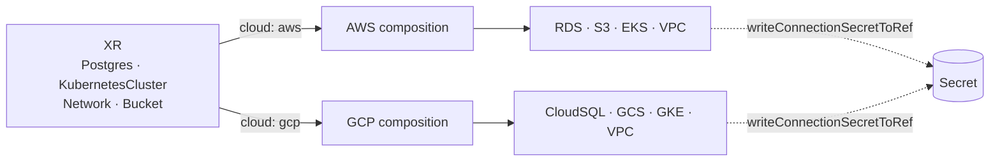

# skylab-crossplane

Cloud-agnostic Crossplane XRDs and compositions for the **Skylab** platform, packaged as an OCI Configuration published at `ghcr.io/skylarhoughtongithub/skylab-platform`.

A developer asks for a `KubernetesCluster`, `Network`, `Postgres`, or `Bucket`; which cloud fulfills it is a composition decision selected by a single `cloud` parameter on the XR. [`skylab-gitops`](https://github.com/SkylarHoughtonGithub/skylab-gitops) pins a version of this package at wave 2.

## Architecture



### Published XRDs

| XRD | AWS composes | GCP composes | Version |
| --- | --- | --- | --- |
| `Bucket` | S3 bucket | GCS bucket | v0.1.0 |
| `Network` (public VPC) | VPC + public subnets | VPC + public subnets | v0.2.0 |
| `KubernetesCluster` | EKS + Argo CD cluster-Secret handoff | GKE + Argo CD cluster-Secret handoff | v0.3.0 |
| `Postgres` | RDS Instance | CloudSQL DatabaseInstance + Database + User | v0.4.0 |

### Design decisions

**Crossplane v2.** Namespaced XRs with pipeline-mode compositions and functions. No v1-style claims — the KubeVela component (or the Backstage template that generates it) is the developer-facing request.

**One cloud parameter.** Each XRD has AWS and GCP compositions; `spec.cloud: aws | gcp` on the XR selects. No provider-specific fields leak upward to the developer.

**Cluster handoff to Argo CD.** Every `KubernetesCluster` composition also creates an Argo CD cluster Secret on the hub via `provider-kubernetes`, carrying env labels and either EKS `awsAuthConfig` or the GKE `argocd-k8s-auth gcp` exec provider. Deleting the XR removes the Secret, so the cluster leaves the fleet automatically.

**Composition selection via function**, not labels — so cloud routing is testable with `crossplane composition render`.

## Repo layout

```
skylab-crossplane/
├── crossplane.yaml    # Configuration metadata + provider / function dependencies
├── apis/              # one directory per XRD
│   ├── bucket/
│   ├── kubernetes-cluster/
│   ├── network/
│   └── postgres/
├── examples/          # example XRs, one aws.yaml and one gcp.yaml per XRD
├── tests/             # expected render output per example (diffed in CI)
├── scripts/
│   ├── render.sh      # crossplane composition render across every example + diff
│   └── validate.sh    # crossplane xpkg build — structural check
└── plan.md
```

## Local dev

Requires the [Crossplane CLI](https://docs.crossplane.io/) and a working Docker daemon.

```sh
./scripts/validate.sh    # structural check (xpkg build)
./scripts/render.sh      # render every example and diff against tests/
```

`render.sh` normalizes output before diffing (redacts timestamps, sorts documents by apiVersion+kind+name) so re-runs are deterministic.

## Release flow

PR titles use [Conventional Commits](https://www.conventionalcommits.org/). On merge to `main`, `release-please` opens a release PR that computes the next version from commit history. Merging that PR cuts a Git tag; `release.yaml` builds the xpkg and pushes `ghcr.io/skylarhoughtongithub/skylab-platform:v<version>`.

`release.yaml` also accepts `workflow_dispatch` with a `tag` input for one-off backfill publishes.

## Cross-repo map

| Repo | Role |
| --- | --- |
| [skylab-gitops](https://github.com/SkylarHoughtonGithub/skylab-gitops) | Installs Crossplane and providers at wave 1; pins this package at wave 2 |
| [skylab-terraform](https://github.com/SkylarHoughtonGithub/skylab-terraform) | Provides IAM for `provider-aws` and GCP service accounts for `provider-gcp` |
| [skylab-backstage](https://github.com/SkylarHoughtonGithub/skylab-backstage) | Cluster and database golden-path templates reference these XRDs |

## Where to go next

- **[`plan.md`](plan.md)** — current status, remaining XRDs (NAT + private subnets, access/RBAC), roadmap.
- **[`AGENTS.md`](AGENTS.md)** — engineering context for coding agents.
- **[`examples/`](examples/)** — minimal XRs to render or apply.
